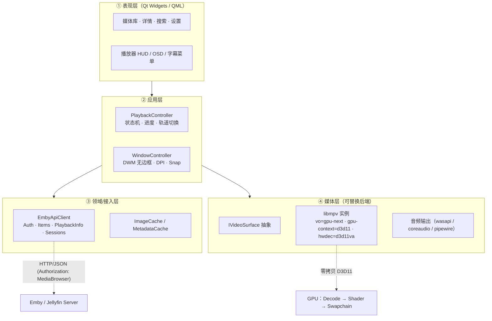

# 自研 Emby PC 客户端：架构与技术选型调研

> 目标：在架构上避开 qEmby 的三个已知坑——**播放时 GPU 占用偏高、窗口有最小尺寸限制、贴边有缝**。
> 参考仓库：`/root/github/emby-pc/qEmby`（Qt6 Widgets + C++20 + libmpv + QWindowKit，只读）。
> 结论均附官方文档 URL；qEmby 结论附 `file:line`。

## 0. 结论摘要（先看这 5 条）

1. **推荐栈**：Qt 6.8+（Widgets 或 QML）+ **libmpv 原生 D3D11 输出**。视频表面与 UI 分离：默认用子 HWND（`--wid`）让 mpv 自建 D3D11 swapchain；进阶用 `MPV_RENDER_API_TYPE_D3D11` 自建 swapchain。
2. **GPU 高的根因不是 libmpv**，而是 qEmby 的默认参数三连击：`hwdec=auto-copy`（解码帧 GPU→RAM→GPU）、Windows 上 `gpu-api=opengl`（GL/ANGLE 翻译 + QOpenGLWidget FBO 二次合成）、`video-sync=display-resample` 且连带 `interpolation=yes`（默认开补帧）。
3. **窗口问题的根因**是 QWindowKit 自绘边框模式（`QWINDOWKIT_ENABLE_WINDOWS_SYSTEM_BORDERS=OFF`）与硬编码最小尺寸：该模式注入 `extra-margins=(1,1,1,1)`（四边 1px 缝），Win10 再叠加 `(0,1,0,0)`。
4. **三条不可妥协的决策**：① 硬解永不用 `*-copy`；② 视频渲染不经过 Qt 的 FBO/合成器；③ 无边框窗口用原生 DWM 方案，不引入 QWindowKit。
5. **MVP 先做“API + 播放内核”两周 spike**：先用 `mpv --wid` 跑通零拷贝 D3D11，再铺 UI；否则 UI 做完再换渲染路径会返工。

## 1. 推荐架构（分层图）



**各层职责与边界**

| 层 | 职责 | 关键约束 |
|---|---|---|
| ① 表现层 | 浏览、详情、播放 HUD；不直接碰 mpv/HWND | UI 线程不做网络/解码 |
| ② 应用层 | 播放状态机（Idle→Preparing→Playing→Paused→Stopped）、错误重试、进度上报节流 | 所有异步回调带 generation id，防止切集串台 |
| ③ 接入层 | 认证、库浏览、PlaybackInfo 协商、图片 URL、会话上报 | 只依赖 HTTP，可单测；不依赖 Qt Widgets |
| ④ 媒体层 | 封装 libmpv：命令、属性、事件、视频表面 | 对外只暴露 `play/pause/seek/setVolume/...` 与 Qt 信号 |

**视频表面抽象（跨平台的关键）**

```cpp
class IVideoSurface {                 // 由窗口层实现，播放器层只认这个接口
public:
  virtual void attach(mpv_handle* mpv) = 0;   // 创建/绑定原生表面
  virtual void resize(int w, int h, qreal dpr) = 0;
  virtual void setVisible(bool) = 0;
};
// Windows 默认：Win32ChildSurface（HWND + --wid + gpu-context=d3d11）
// Windows 进阶：D3D11RenderSurface（MPV_RENDER_API_TYPE_D3D11 + 自建 DXGI swapchain）
// macOS/Linux：OpenGLRenderSurface（MPV_RENDER_API_TYPE_OPENGL + QOpenGLWidget/QRhiWidget）
```

## 2. 播放内核选型对比

| 方案 | 零拷贝硬解难度 | GPU 占用 | 跨平台 | 许可证 | 开发成本 | 结论 |
|---|---|---|---|---|---|---|
| **libmpv + `--wid` 子窗口嵌入**（本进程；`vo=gpu-next` + `gpu-context=d3d11`） | **低**：mpv 自建 D3D11 swapchain，d3d11va 直出 | **最低**（Qt 不参与视频合成） | Win 最佳；Linux X11/macOS 有宿主窗口坑 | libmpv GPLv2+，`-Dgpl=false` 可 LGPLv2.1+ | 低 | **Windows MVP 首选** |
| **libmpv + 独立渲染窗口**（mpv 自建顶层窗口） | **低** | **最低** | 三平台均可 | 同上 | 低 | 最省事；但两个窗口、HUD 需另开 overlay |
| **libmpv D3D11 render API**（`MPV_RENDER_API_TYPE_D3D11`） | **最低**：与 mpv 共用同一 ID3D11Device，解码纹理直接采样 | **最低**（可自建 swapchain，无 Qt blit） | 仅 Windows | 同上 | 中高（swapchain/DPI/HDR 自理） | 单窗口一体化的最终形态 |
| **libmpv OpenGL render API**（QOpenGLWidget / QRhiWidget） | **难**：Windows 上 d3d11va 需 d3d11 context；外部 WGL 常退化为 `*-copy` | 中-高（多一次 FBO 合成；GL/ANGLE 翻译） | **最好** | 同上 | 中 | qEmby 现状，**避开** |
| **mpv 子进程 + JSON IPC** | **低**：mpv 自己开窗口 | **最低** | 好（三平台都有 mpv） | mpv 二进制 GPLv2+（独立进程通常按聚合处理） | **最低** | 快速验证/外挂播放器可用，产品集成差 |
| **libVLC**（`libvlc_media_player_set_hwnd` / video callbacks） | 中：hwnd 模式简单，但自绘/零拷贝要写 vout callbacks | 中 | 好 | **LGPL2.1**（商业友好） | 中 | 备选；字幕/ASS、格式覆盖弱于 mpv |
| **Electron / CEF HTML5 video** | 由 Chromium 管，但受 codec/容器限制 | 中（Chromium 合成层） | 最好 | Electron **MIT**；Chromium/FFmpeg 第三方许可 | 低（UI 快） | 只适合“Web 壳”，不适合作为高端播放器 |
| **WebView2** | 同 Chromium，取决于 Edge 运行时 | 中 | **仅 Windows** | MS SDK/运行时许可 | 低 | Windows 专用备选 |
| **FFmpeg + 自研 D3D11/Vulkan 渲染** | 可做到极致 | 最低（可控） | 差（每平台重写） | FFmpeg LGPL/GPL | **极高** | 不推荐 MVP |

**为什么 Windows 上必须走 D3D11 原生输出（而不是 qEmby 的 GL 嵌入）**

- mpv 手册明确：`auto-copy` 是“只选把解码数据**复制回系统内存**的模式”，且“这些 copy 模式通常比 direct 模式低效”（[mpv manual · hwdec](https://mpv.io/manual/master/#options-hwdec)）。qEmby 默认 `hwdec=auto-copy`（`mpvcontroller.cpp:157`），设置页甚至只提供 `auto-copy / d3d11va-copy / dxva2-copy / cuda-copy` 四种**全是 copy-back** 的选项（`pageplayer.cpp:57-61`）——这是 GPU 占用高的第一主因。
- `d3d11va` 的直出要求 `--vo=gpu|gpu-next` + `--gpu-context=d3d11`（或 angle）；qEmby 在 Windows 上却强制 `gpu-api=opengl`（`mpvcontroller.cpp:160`），把 D3D11 解码与 GL 呈现拆成两条路，只能走 copy。
- mpv 渲染 API 现已提供 **D3D11 后端**：`MPV_RENDER_PARAM_D3D11_FBO` 直接渲染到应用提供的 D3D11 texture，且 `d3d11va` 在传入的同一 device 上解码（[render.h](https://github.com/mpv-player/mpv/blob/master/include/mpv/render.h)、[render_d3d11.h](https://github.com/mpv-player/mpv/blob/master/include/mpv/render_d3d11.h)）。这是“单窗口 + 零拷贝”的正解。
- qEmby 在弹幕开启时还额外走 `paintNativeComposite`：mpv 先渲染到离屏 FBO，再 `QOpenGLTextureBlitter` 拷到默认 FBO（`mpvwidget.cpp:513-540, 560-569`）——每帧多一次全屏 blit，这是第二层额外开销。
- mpv 官方也承认窗口嵌入（`--wid`）比 render API 简单但“有各种问题”，且只在 X11/win32/macOS 可用（[client.h · Embedding the video window](https://github.com/mpv-player/mpv/blob/master/include/mpv/client.h)）。Windows 是它最成熟、收益最大的平台。

## 3. mpv 低 GPU 配置基线

**推荐值（Windows 播放器默认 profile）**

| 选项 | 推荐值 | 原因 / 出处 |
|---|---|---|
| `vo` | `gpu-next` | libplacebo 后端；显式指定，不依赖版本默认（[mpv manual · vo](https://mpv.io/manual/master/#video-output-drivers)） |
| `gpu-api` / `gpu-context` | `d3d11` / `d3d11` | 与 d3d11va 同一条 D3D11 路径；避免 GL/ANGLE 翻译（[gpu-api](https://mpv.io/manual/master/#options-gpu-api)） |
| `hwdec` | Windows：`d3d11va`；macOS/Linux：`auto-safe` | 直出（非 copy）；`auto-safe` 新版等同 `auto`（[hwdec](https://mpv.io/manual/master/#options-hwdec)） |
| `d3d11va-zero-copy` | `yes`（可选，先 A/B） | 默认还会做一次 GPU→GPU 拷贝；开启后直接采样解码表面，省带宽，但个别驱动有边缘伪影（[manual](https://mpv.io/manual/master/#options-d3d11va-zero-copy)） |
| `video-sync` | `audio`（默认） | 最稳健；`display-resample` 需 vsync-blocked 呈现，且对 24p→60Hz 会改音频速度（[video-sync](https://mpv.io/manual/master/#options-video-sync)） |
| `interpolation` | `no`，**显式写死** | 只在 `display-*` 下生效；沿时间轴卷积补帧，GPU 开销显著（[interpolation](https://mpv.io/manual/master/#options-interpolation)）。qEmby 在 `display-resample` 时自动设 `yes`（`mpvcontroller.cpp:149`）——这是 GPU 高的第二主因 |
| `blend-subtitles` | `no` | `video` 会把字幕烧进视频帧，触发重渲染；qEmby 用 `video`（`mpvcontroller.cpp:132`） |
| `osc` / `config` / `load-scripts` | `no` | 嵌入式播放器自带 UI，避免用户 mpv.conf 污染（qEmby 已做，`mpvcontroller.cpp:117-121`，可抄） |
| `keep-open` | `yes` | 播完停在最后一帧，便于 UI 收尾 |
| `cache` / `demuxer-max-bytes` | `yes` / `512MiB` | 网络流抗抖动（按内存预算调整） |
| `hwdec-codecs` | `all`（可选） | 让更多 codec 走硬解；验证 `hwdec-current` 实际生效 |

```ini
# mpv.conf（嵌入播放器专用，程序启动时注入）
vo=gpu-next
gpu-api=d3d11
gpu-context=d3d11
hwdec=d3d11va
# d3d11va-zero-copy=yes   # 逐机型灰度
video-sync=audio
interpolation=no
blend-subtitles=no
osc=no
config=no
load-scripts=no
keep-open=yes
cache=yes
demuxer-max-bytes=512MiB
```

**验收基准**：`hwdec-current` 必须是 `d3d11va`（不是 `d3d11va-copy`）；`current-vo` 为 `gpu-next`；播放 4K HEVC 10bit 时任务管理器 GPU 的 **Video Decode** 引擎有负载、**3D** 引擎显著低于 qEmby 基线；连续播放 10 分钟 `hwdec-current` 不回落。

## 4. 无边框窗口正确实现（Windows）

### 4.1 原生方案（不引入 QWindowKit）

1. **窗口样式**：不要只依赖 `Qt::FramelessWindowHint`——Qt 在 Windows 上会直接设 `WS_POPUP`，连 `WS_THICKFRAME` 都没有，结果是没 DWM 阴影、没原生缩放边框（Qt 源码 `qwindowswindow.cpp`：`if (flags & Qt::FramelessWindowHint) style = WS_POPUP;`）。正确做法：先用普通顶层窗口，再用 `SetWindowLongPtr` 加回 `WS_THICKFRAME`（可保留 `WS_CAPTION`），然后 `WM_NCCALCSIZE` 返回 0 去掉标题栏；QWindowKit 内部也是 `style | WS_THICKFRAME | WS_CAPTION`（`libs/qwindowkit/src/core/contexts/win32windowcontext.cpp:920-927`）。
2. **`WM_NCCALCSIZE`**：`wParam=TRUE` 时返回 0 可去掉标准边框、整个窗口都作为客户区（[MSDN](https://learn.microsoft.com/en-us/windows/win32/winmsg/wm-nccalcsize)）。
   - **最大化时必须特殊处理**：Windows 会把最大化窗口的 window rect 撑到比显示器大一圈（不可见 resize border）。若直接返回 0，客户区会溢出屏幕导致内容被裁；若只把 clientRect 内缩，则出现一圈“缝”。正确做法：比较 `MonitorFromWindow` + `GetMonitorInfo` 的 `rcMonitor/rcWork` 与 window rect，把客户区**夹到显示器工作区**；任务栏自动隐藏时再补 1-2px。
   - 参考实现（反面教材）：QWindowKit 在 `QWINDOWKIT_ENABLE_WINDOWS_SYSTEM_BORDERS=OFF` 时给窗口设 `extra-margins=QMargins(1,1,1,1)`（`libs/qwindowkit/src/core/contexts/win32windowcontext.cpp:909-916`），Win10 下又叠加 `extra-margins=(0,1,0,0)`（`libs/qwindowkit/src/core/shared/windows10borderhandler_p.h:37-38, 76-77`）——这就是贴边 1px 缝的直接来源；最大化时它只对 clientRect 做 top+frame / 其余 -frame 的调整（`win32windowcontext.cpp:2196-2209`），不修正 window rect，边缘仍会差 1-2px。
3. **`DwmExtendFrameIntoClientArea`**：在 `WM_ACTIVATE` 中调用（MS 示例明确说明这样在默认大小和最大化时都正确），`MARGINS{-1,-1,-1,-1}` 可保留 DWM 阴影/圆角（[MSDN custom frame](https://learn.microsoft.com/en-us/windows/win32/dwm/customframe)）。
4. **可见边界**：`DwmGetWindowAttribute(hwnd, DWMWA_EXTENDED_FRAME_BOUNDS, &rect, sizeof(rect))` 返回**不含不可见边框**的屏幕坐标（[MSDN DWMWA](https://learn.microsoft.com/en-us/windows/win32/api/dwmapi/ne-dwmapi-dwmwindowattribute)）；窗口定位、缩略图、贴边对齐一律用它，不要用 `GetWindowRect`。
5. **`WM_GETMINMAXINFO`**：把 `ptMaxPosition/ptMaxSize` 限定到显示器工作区，避免最大化盖住任务栏 / 多显示器错位。
6. **命中测试**：`WM_NCHITTEST` 对 6-8px 边缘返回 `HTLEFT/HTRIGHT/HTTOP/HTTOPLEFT...`，标题栏区域返回 `HTCAPTION`；这样系统原生的拖动、双击最大化、Aero Snap、Win11 Snap Layouts 全部可用。也可在 Qt 里调用 `windowHandle()->startSystemMove()` / `startSystemResize(Qt::Edges)`（[QWindow docs](https://doc.qt.io/qt-6/qwindow.html)），但**不要**用 `setGeometry` 手搓拖动。
7. **DPI/清单**：manifest 声明 `PerMonitorV2` + Windows 10/11 支持（QWindowKit 文档也强调：没有 Win11 manifest，Snap Layouts 不生效）；不要混用 `QScreen::availableGeometry()` 与 window rect 做最大化几何。
8. **最小尺寸**：播放窗口 `setMinimumSize(0,0)`，所有 `minimumSizeHint()` 可返回 0，HUD 用可折叠布局/QScrollArea；验收 640×360 与 320×180。qEmby 在 `playbackmanager.cpp:853` 硬编码 `setMinimumSize(960, 540)`，主窗口 `mainwindow.cpp:1065` 设 `900×600`——这是“不能缩小”的直接原因。
9. **状态恢复**：用 `QWidget::normalGeometry()` 保存普通态几何；**不要**像 qEmby 那样在 `showNormal()` 前抓 `geometry()`（`mainwindow.cpp:1292-1296`），最大化时抓到的矩形含不可见边框，恢复后会偏移/超屏。

### 4.2 QOpenGLWidget / QRhiWidget / QWindow 的合成差异

| 载体 | 每帧路径 | 额外全屏拷贝 | 说明 |
|---|---|---|---|
| `QOpenGLWidget` | mpv→widget FBO→Qt backing store 合成→DWM | **1 次**（+ GL/ANGLE 翻译） | Qt 文档：所有渲染进入 FBO，“没有真正的 onscreen native surface，由 widget 栈管理合成和 swap”（[QOpenGLWidget](https://doc.qt.io/qt-6/qopenglwidget.html)）。qEmby 即此路径（`mpvwidget.cpp:23, 359-368`） |
| `QRhiWidget`（**Qt 6.7+**，不是 6.6） | mpv→QRhi 隐式 texture→Qt 合成器→DWM | **1 次**，但 Windows 默认 D3D11 后端，无 ANGLE | 文档：渲染进“隐式创建和管理的 2D texture”，Windows 默认 D3D11（[QRhiWidget](https://doc.qt.io/qt-6/qrhiwidget.html)） |
| 子 HWND / 独立 QWindow（mpv 自绘） | mpv→D3D11 swapchain→DWM | **0 次** | GPU 最优；Qt 只画 HUD（需独立 layered window 或 mpv OSD） |

> 经验法则：**视频像素不要穿过 Qt 的合成器**。一旦穿过，至少多一次全屏 blit；如果还叠加弹幕/字幕缓存，就会像 qEmby 一样翻倍。

## 5. Emby / Jellyfin 接入：最小可行调用序列

| # | 方法 & 路径 | 关键字段/说明 |
|---|---|---|
| 0 | `GET /System/Info/Public` | `ServerName`、`Version`、`ProductName`（含 "Jellyfin" 即 Jellyfin） |
| 1 | `POST /Users/AuthenticateByName` | body `{"Username":"...","Pw":"..."}`；请求头 `X-Emby-Authorization: MediaBrowser Client="...", Device="...", DeviceId="...", Version="..."`；响应取 `AccessToken`、`User.Id`、`User.Policy`（[Emby 认证文档](https://dev.emby.media/doc/restapi/User-Authentication.html)） |
| 2 | 后续请求 | Emby：`X-Emby-Token: <token>`；Jellyfin：优先 `Authorization: MediaBrowser Client="...", Device="...", DeviceId="...", Version="...", Token="..."`（[Jellyfin 授权规范](https://gist.github.com/nielsvanvelzen/ea047d9028f676185832e51ffaf12a6f)） |
| 3 | `GET /Users/{userId}/Items?...` | `ParentId`、`Recursive=true`、`IncludeItemTypes=Movie,Series,Episode`、`Fields=MediaSources,MediaStreams,Overview`、`ImageTypeLimit=1` |
| 4 | `POST /Items/{id}/PlaybackInfo?UserId={userId}` | body 里带 `DeviceProfile` + `EnableDirectPlay/EnableDirectStream/EnableTranscoding`；响应 `PlaySessionId` + `MediaSources[]`（[Emby PlaybackInfo](https://dev.emby.media/reference/RestAPI/MediaInfoService/postItemsByIdPlaybackinfo.html)） |
| 5 | 选择播放方式 | `SupportsDirectPlay` → 直连 URL；否则 `DirectStreamUrl`；否则 `TranscodingUrl`（HLS） |
| 6 | 直连 URL | `/Videos/{id}/stream?static=true&mediaSourceId={sid}`（Emby 文档；`/Video/{id}/stream` 为等价别名，[Video Streaming](https://dev.emby.media/doc/restapi/Video-Streaming.html)） |
| 7 | `POST /Sessions/Playing` | `ItemId/MediaSourceId/PlaySessionId/PositionTicks/PlayMethod/CanSeek/IsPaused/IsMuted/QueueableMediaTypes`（[Check-ins](https://dev.emby.media/doc/restapi/Playback-Check-ins.html)） |
| 8 | `POST /Sessions/Playing/Progress` | 每 10s + 暂停/切轨/拖动时；加 `EventName=TimeUpdate/Pause/Unpause/AudioTrackChange/SubtitleTrackChange...` |
| 9 | `POST /Sessions/Playing/Stopped` | 播放结束/关闭时上报最终位置 |

**PlaybackInfo 请求示例（MVP 可直接用）**

```json
POST /Items/{id}/PlaybackInfo?UserId={userId}
{
  "UserId": "{userId}",
  "MaxStreamingBitrate": 120000000,
  "EnableDirectPlay": true,
  "EnableDirectStream": true,
  "EnableTranscoding": true,
  "DeviceProfile": {
    "Name": "MyEmbyPC",
    "MaxStreamingBitrate": 120000000,
    "DirectPlayProfiles": [{
      "Type": "Video",
      "Container": "mkv,mp4,m4v,webm,ts,mpegts",
      "VideoCodec": "h264,hevc,av1,vp9,mpeg2video",
      "AudioCodec": "aac,mp3,ac3,eac3,flac,opus,dts"
    }],
    "TranscodingProfiles": [{
      "Type": "Video", "Context": "Streaming", "Protocol": "hls",
      "Container": "ts", "VideoCodec": "h264", "AudioCodec": "aac"
    }]
  }
}
```

**播放器取流**：把 URL 交给 mpv 时用 `--http-header-fields="X-Emby-Token: <token>"`（Jellyfin 12 用 `Authorization: MediaBrowser ...`；值里的逗号需按 mpv 列表选项语法转义），**不要把 token 拼进 URL**。qEmby 用 `?api_key=`（`mediaservice.cpp:3026`）会进反向代理日志，且 Jellyfin 12 已移除 `api_key`/`X-Emby-Token` 等旧方式。

**Jellyfin 兼容性**：端点、字段与 Emby 基本一致（Jellyfin 是 Emby fork），但注意三点：① 认证头按上表用标准 `Authorization`；② `ProductName` 判定分支；③ Jellyfin 12 起旧头（`X-Emby-Token`、`X-MediaBrowser-Token`、`X-Emby-Authorization`、`api_key`）全部移除。qEmby 只发 `X-Emby-Authorization`（`apiclient.cpp:17-26`）——在 Jellyfin 12 上会直接 401。

## 6. 参考实现盘点

| 项目 | 技术栈 | 视频路径 | 值得抄 / 教训 |
|---|---|---|---|
| **jellyfin/jellyfin-media-player**（现更名 jellyfin-desktop） | Qt WebEngine（Chromium 客户端 UI）+ Qt Quick Window + **libmpv**（libmpvqt `MpvVideoItem`） | `vo=libmpv` OpenGL render API；Windows 强制 `gpu-api=opengl`（`MpvVideoItem.cpp`） | 抄：Web 客户端复用 + 原生视频层混合、QML 叠层；避：GL 路径与 Chromium 合成叠加，GPU 不是最优；GPL-2.0 |
| **mpv.net** | C#/.NET + WPF + libmpv，Windows-only | libmpv + 原生 Win32 窗口宿主（`wid`，`Player.cs:100`） | 抄：单进程 libmpv 嵌入、原生窗口承载；适合参考“简单可靠”的 Windows 宿主方案 |
| **Emby Theater** | Electron（Chromium + Node）+ HTML/JS UI；旧版 Windows 播放走 DirectShow/madVR | HTML5 video / 外部播放器 | 抄：UI 交付速度；避：HTML5 容器/字幕限制导致服务端转码，画质/GPU 不可控 |
| **mpv `--wid` 方案** | 任意 GUI + mpv 子窗口 | 原生窗口嵌入 | 优点：实现最快、GPU 最低；缺点：mpv 官方称“有各种问题”，仅 X11/win32/macOS；X11 焦点、macOS 稳定性、无 OSD 叠加（[client.h](https://github.com/mpv-player/mpv/blob/master/include/mpv/client.h)、[mpv-examples](https://github.com/mpv-player/mpv-examples/tree/master/libmpv#methods-of-embedding-the-video-window)） |

## 7. 关键决策表（从 qEmby 抄什么 / 避什么）

| 决策点 | 推荐 | qEmby 现状（file:line） | 抄/避 |
|---|---|---|---|
| 硬解模式 | `d3d11va`（Win）/ `auto-safe`（其他），永不 `*-copy` | 默认 `auto-copy`（`mpvcontroller.cpp:157`）；设置页四种全是 copy（`pageplayer.cpp:57-61`） | **避**（GPU 主因） |
| 图形 API | `gpu-api=d3d11` + `gpu-context=d3d11` | Windows 强制 `gpu-api=opengl`（`mpvcontroller.cpp:160`） | **避** |
| 帧同步/补帧 | `video-sync=audio`、`interpolation=no` 写死 | 默认 `display-resample`，且自动 `interpolation=yes`（`mpvcontroller.cpp:145-149`） | **避**（GPU 第二主因） |
| 字幕合成 | `blend-subtitles=no` | `blend-subtitles=video`（`mpvcontroller.cpp:132`） | **避** |
| 视频表面 | 子 HWND / D3D11 render API，不经 Qt 合成 | `QOpenGLWidget` + OpenGL render API（`mpvwidget.cpp:23, 359-368`） | **避** |
| 弹幕等叠加 | 独立透明 overlay 窗口或 mpv OSD；不做视频帧二次合成 | 离屏 FBO + 每帧 blit（`mpvwidget.cpp:513-540, 560-569`） | **避** |
| 无边框窗口 | 原生 DWM：`WM_NCCALCSIZE`/`WM_GETMINMAXINFO`/`startSystemMove/Resize` | QWindowKit + `QWINDOWKIT_ENABLE_WINDOWS_SYSTEM_BORDERS=OFF`（`CMakeLists.txt:96-107`；`playerwindow.cpp:22`） | **避** |
| 最小尺寸 | 播放窗 `0,0`；布局可收缩 | `setMinimumSize(960,540)`（`playbackmanager.cpp:853`）；`900×600`（`mainwindow.cpp:1065`） | **避** |
| 最大化/贴边 | 客户区夹到 monitor work area；用 `DWMWA_EXTENDED_FRAME_BOUNDS` | system-borders OFF 时 `extra-margins(1,1,1,1)`（`win32windowcontext.cpp:909-916`）；Win10 再叠加 `(0,1,0,0)`（`windows10borderhandler_p.h:37-38`）；最大化只调 clientRect（`win32windowcontext.cpp:2196-2209`） | **避** |
| 窗口状态恢复 | 保存 `normalGeometry()` | `showNormal()` 前抓 `geometry()`（`mainwindow.cpp:1292-1296`） | **避** |
| 认证头 | 标准 `Authorization: MediaBrowser ...` + Emby `X-Emby-Token` | 只有 `X-Emby-Authorization`（`apiclient.cpp:17-26`） | **半抄**（补标准头） |
| 播放 URL | header 传 token | `?api_key=`（`mediaservice.cpp:3026`） | **避**（泄露 + Jellyfin 12 移除） |
| DeviceProfile | **每次** PlaybackInfo 都带 | 只在直播时带（`mediaservice.cpp:2772-2786`） | **避**（否则只能按服务端默认策略协商，可能转码/选错源） |
| 进度上报 | 抄 payload 结构 + 节流 | `/Sessions/Playing`（`mediaservice.cpp:3151-3188`）、Progress（`3200-3238`）、Stopped（`3241-3275`） | **抄** |
| 异步生命周期守卫 | `QPointer` + generation 校验 | `mediaservice.cpp:2789-2793, 3166-3177` | **抄** |
| mpv 预热 | 后台线程预初始化 libmpv/FFmpeg | `warmupOnce()`（`mpvcontroller.cpp:52-101`） | **抄** |
| 播放器 UI | 状态机 + HUD 组件化 | `playerview.cpp` 5877 行单体 | **只抄交互，不抄结构** |

> 许可证提醒：qEmby 声明 MIT，但 libmpv 若用默认 GPL 构建分发，MIT 声明与分发义务需重新评估；自研若闭源，应使用 `-Dgpl=false` 的 LGPL 构建并在法律上确认（[mpv Copyright](https://github.com/mpv-player/mpv/blob/master/Copyright)）。

## 8. MVP 落地步骤

| 阶段 | 内容 | 退出标准 | 估时 |
|---|---|---|---|
| P0 基线测量 | 在目标机器上用 qEmby 播 4K HEVC 10bit，记录 GPU 引擎占用（任务管理器/PresentMon）+ `hwdec-current`/`current-vo` | 有可对比的数字基线（截图/日志） | 1 天 |
| P1 API 骨架 | 认证 + `/Users/{id}/Items` + `PlaybackInfo` + 直连 URL + Progress/Stopped | 命令行能登录、列出库、拿到可播放 URL、服务端 dashboard 有进度 | 3-5 天 |
| P2 播放 spike | Qt 空窗口 + `--wid` 子 HWND + `vo=gpu-next/gpu-context=d3d11/hwdec=d3d11va`；接 `http-header-fields` | `hwdec-current=d3d11va`；GPU 3D 明显低于 qEmby；拖动/暂停正常 | 2-3 天 |
| P3 播放器 UI | HUD、seek、音量、音轨/字幕、快捷键、进度上报、错误重试 | 连续 2h 播放无泄漏/卡死 | 1 周 |
| P4 媒体库 UI | 首页/网格/详情/搜索/图片缓存 | 1000 部影片滚动 60fps | 1-2 周 |
| P5 无边框窗口 | 原生 DWM 方案 + DPI + Snap + 最小尺寸 0 | 贴边/最大化截图无 1px 缝；320×180 可缩小 | 3-5 天 |
| P6 打包/灰度 | 安装包、自动更新、崩溃日志、灰度开关（D3D11 zero-copy 按机型） | 干净机器安装即用 | 1 周 |

## 9. 验收清单（可直接当测试用例）

- **GPU**：4K HEVC 10bit 60Mbps，播放 10 分钟：`hwdec-current=d3d11va`；GPU Video Decode 有负载；3D 引擎占用比 qEmby 基线低 ≥30%；无 `*-copy` 字样。
- **窗口**：最大化四边像素级贴合（截图检查最外 1px）；拖到屏幕左/右/上边缘无缝隙；任务栏自动隐藏模式无遮挡；混合 DPI 双屏来回拖动不模糊；320×180 仍可播放。
- **API**：Emby 4.8/4.9、Jellyfin 10.9/11 全部跑通；Jellyfin 12（旧头移除）用 `Authorization` 通过；直连播放率 ≥80%（不必要转码）。
- **稳定性**：快速切集 100 次无崩溃；断网重连恢复；暂停 30 分钟后继续进度正确。

## 10. 主要来源

- Emby：认证 https://dev.emby.media/doc/restapi/User-Authentication.html · 视频流 https://dev.emby.media/doc/restapi/Video-Streaming.html · 进度上报 https://dev.emby.media/doc/restapi/Playback-Check-ins.html · PlaybackInfo https://dev.emby.media/reference/RestAPI/MediaInfoService/postItemsByIdPlaybackinfo.html · 播放策略 https://dev.emby.media/doc/restapi/Playback-Guidelines.html
- Jellyfin：API 文档 https://api.jellyfin.org/ · 授权头规范 https://gist.github.com/nielsvanvelzen/ea047d9028f676185832e51ffaf12a6f
- mpv：手册 https://mpv.io/manual/master/ · render API https://github.com/mpv-player/mpv/blob/master/include/mpv/render.h · D3D11 render https://github.com/mpv-player/mpv/blob/master/include/mpv/render_d3d11.h · client.h 嵌入说明 https://github.com/mpv-player/mpv/blob/master/include/mpv/client.h · 嵌入方式对比 https://github.com/mpv-player/mpv-examples/tree/master/libmpv#methods-of-embedding-the-video-window · 许可证 https://github.com/mpv-player/mpv/blob/master/Copyright
- Qt：QWindow（startSystemMove/Resize）https://doc.qt.io/qt-6/qwindow.html · QOpenGLWidget https://doc.qt.io/qt-6/qopenglwidget.html · QRhiWidget https://doc.qt.io/qt-6/qrhiwidget.html · Qt 许可 https://doc.qt.io/qt-6/licensing.html
- Microsoft：WM_NCCALCSIZE https://learn.microsoft.com/en-us/windows/win32/winmsg/wm-nccalcsize · 自定义窗口框架 https://learn.microsoft.com/en-us/windows/win32/dwm/customframe · DWMWA_EXTENDED_FRAME_BOUNDS https://learn.microsoft.com/en-us/windows/win32/api/dwmapi/ne-dwmapi-dwmwindowattribute · DwmExtendFrameIntoClientArea https://learn.microsoft.com/en-us/windows/win32/api/dwmapi/nf-dwmapi-dwmExtendFrameIntoClientArea
- 参考项目：jellyfin-desktop https://github.com/jellyfin/jellyfin-desktop · mpv.net https://github.com/mpvnet-player/mpv.net · Emby Theater https://github.com/MediaBrowser/emby-theater-windows · libVLC 许可 https://www.videolan.org/vlc/libvlc.html · Electron 许可 https://github.com/electron/electron/blob/main/LICENSE · WebView2 分发 https://learn.microsoft.com/en-us/microsoft-edge/webview2/concepts/distribution
- qEmby 本仓库：`src/qEmbyApp/components/mpvcontroller.cpp`、`mpvwidget.cpp`、`playerwindow.cpp`、`src/qEmbyApp/managers/playbackmanager.cpp`、`src/qEmbyApp/mainwindow.cpp`、`src/qEmbyApp/views/settings/pageplayer.cpp`、`src/qEmbyCore/api/apiclient.cpp`、`src/qEmbyCore/services/media/mediaservice.cpp`、`libs/qwindowkit/src/core/...`

> 附：qEmby 的具体 GPU 根因清单见 `reports/gpu-decode.md`（video-analyst），窗口最小尺寸/贴边缝的逐行根因见 `reports/window.md`（window-analyst）。
